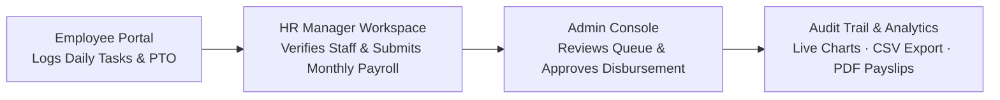

# Staffly — Enterprise Employee Management, Work Sheet & Payroll Platform (Client)

> **One unified workspace. Three purpose-built role portals.**
> Staffly connects daily employee work-sheet tracking, HR onboarding & verification, leave/PTO approvals, executive payroll sign-off, workforce analytics, and audit governance into a single modern web application.

---

## What Staffly Actually Is

Organizations outgrow spreadsheets the moment they need structured accountability between **Employees**, **HR Managers**, and **Admins**. Staffly solves this by separating every operational workflow into role-scoped dashboards backed by a unified API and MongoDB Atlas data layer:

1. **Employees** log daily tasks and hours worked, submit Leave/PTO requests, track payout status, and print official PDF payslips.
2. **HR Managers** verify newly registered employees, inspect individual salary history charts, monitor team work-sheet progress by employee, review leave requests, and submit monthly payroll requests with duplicate-month protection.
3. **Administrators** govern the entire organization—promoting staff to HR, deactivating accounts, approving monthly payroll disbursements, exporting CSV reports, monitoring company-wide workforce analytics, and reviewing immutable audit logs.

---

## System & Payroll Governance Flow



---

## Role-Based Capabilities Matrix

| Module / Capability | Employee | HR Manager | Administrator |
| :--- | :---: | :---: | :---: |
| **Daily Work Sheets** (Add / Edit / Delete Tasks & Hours) | Full | Read (Filtered) | Read (Filtered) |
| **Leave & PTO Requests** (Submit & Track Balance) | Submit & View | Approve / Reject | Approve / Reject |
| **Employee Verification** (Gate before Payroll) | — | Toggle Verified | Full Oversight |
| **Employee Salary History Charts** (Recharts) | — | Full | Full |
| **Monthly Payroll Requests** (Duplicate-Month Guard) | — | Submit Request | — |
| **Payroll Approvals & Disbursement** | View History | View Personal | Approve & Pay |
| **Printable PDF Payslips** | Full | Full | Full |
| **Role Management** (Promote to HR / Deactivate Staff) | — | — | Full |
| **Workforce Analytics** (Payroll Spend & Hours Charts) | — | — | Full |
| **Audit Logs & CSV Governance Exports** | — | — | Full |
| **In-Dashboard Profile & Workspace Settings** | Full | Full | Full |

---

## Frontend Architecture & Design System

- **Framework & Routing:** React 18, Vite 6, React Router v7 with role-aware [`DashboardIndex`](src/Routes/DashboardIndex.jsx) auto-routing and [`PrivateRoute`](src/Routes/PrivateRoute.jsx) protection.
- **UI Component Layer:** Bespoke `shadcn/ui`-style primitives in [`src/components/ui/`](src/components/ui/) (`Button`, `Card`, `Badge`, `Input`, `Select`, `Textarea`, `Label`, `Table`, `Dialog`, `Avatar`, `Separator`) styled with Tailwind CSS (`Plus Jakarta Sans` + `Inter`) and crisp `lucide-react` line icons.
- **Data Fetching & Caching:** TanStack Query v5 + Axios interceptors ([`useAxiosSecure`](src/hooks/useAxiosSecure.jsx) attaching Bearer JWTs, [`useAxiosPublic`](src/hooks/useAxiosPublic.jsx) for public endpoints).
- **Dashboard UX:** Collapsible persistent desktop sidebar (`256px` ↔ `80px` icon rail), sticky breadcrumb utility bar, clickable bottom-sidebar profile card, Recharts analytics visualizations, client-side CSV exports, and branded printable PDF payslips ([`src/lib/enterprise.js`](src/lib/enterprise.js)).
- **Interactive Public Showcase:** Landing page featuring an interactive 3-portal Dashboard preview switcher ([`PlatformShowcase.jsx`](src/components/PlatformShowcase.jsx)), compliance trust pillars, and transparent SaaS pricing tiers ([`PricingSection.jsx`](src/components/PricingSection.jsx)).

---

## Application Route Map

| Route | Access | Description |
| :--- | :--- | :--- |
| `/` | Public | Marketing landing page, interactive 3-role dashboard preview, pricing & trust bar |
| `/contact` | Public | Customer care form with OpenStreetMap office embed & engagement selector |
| `/login` & `/register` | Public | Firebase email/password & Google OAuth; redirects directly into `/dashboard` |
| `/dashboard` | Authenticated | Auto-redirects to `/dashboard/home`, `/dashboard/hr-home`, or `/dashboard/work-sheet` |
| `/dashboard/home` | Admin | Executive KPIs (`Total Staff`, `HR Managers`, `Pending Payrolls`, `Disbursed`) & recent requests |
| `/dashboard/all-employee-list` | Admin | Searchable employee directory, role promotion, deactivation, and CSV export |
| `/dashboard/payroll` | Admin | Monthly payroll approval queue, CSV export, and printable PDF payslips |
| `/dashboard/analytics` | Admin | Recharts visualizations for payroll spend by period and logged hours by category |
| `/dashboard/audit-logs` | Admin | Searchable governance trail with severity badges and CSV export |
| `/dashboard/hr-home` | HR | Employee verification table, monthly pay request modal, and details links |
| `/dashboard/details/:id` | HR | Individual employee profile summary and historical salary bar chart |
| `/dashboard/progress` | Admin / HR | Employee-filterable work-sheet tracker with total hours summary |
| `/dashboard/work-sheet` | Employee | Daily task logger (category, hours, date picker) with inline edit/delete |
| `/dashboard/payment-history` | Employee | Personal payout timeline with printable PDF payslips |
| `/dashboard/leaves` | All Roles | Leave/PTO submission modal, balance tracking, and manager approval queue |
| `/dashboard/profile` | All Roles | In-dashboard account profile with Firebase display-name editing |
| `/dashboard/settings` | All Roles | Firebase password reset trigger, notification switches, and role permissions |

---

## Local Development Setup

### 1. Prerequisites
- Node.js 20+ and npm
- Companion backend repository: [`staffly-full-stack-server`](https://github.com/fakhrul62/staffly-full-stack-server)

### 2. Install Dependencies
```bash
npm install
```

### 3. Configure Environment Variables
Create a `.env.local` file in the project root (automatically gitignored via `*.local`):

```env
VITE_APIKEY=your_firebase_api_key
VITE_AUTHDOMAIN=your_project.firebaseapp.com
VITE_PROJECTID=your_firebase_project_id
VITE_STORAGEBUCKET=your_project.firebasestorage.app
VITE_MESSAGINGSENDERID=your_sender_id
VITE_APPID=your_firebase_app_id
VITE_IMAGE_HOSTING_TOKEN=your_imgbb_api_key
```

### 4. Run & Build
```bash
# Start local Vite dev server (http://localhost:5173)
npm run dev

# Verify production bundle
npm run build
```

---

## Related Repository
- **Backend API Server:** [fakhrul62/staffly-full-stack-server](https://github.com/fakhrul62/staffly-full-stack-server)
